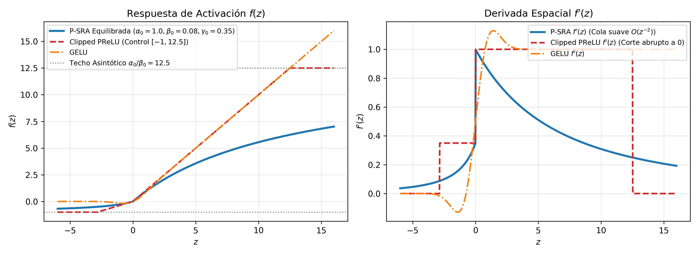

# P-SRA: Parametric Smooth Rational Activation

[](https://doi.org/10.5281/zenodo.24378742)
[](LICENSE)
[](https://www.python.org/)
[](experiments/psra_unified_benchmark.py)
[](paper/)

Official reference implementation and reproducible experimental suite for **P-SRA** (*Parametric Smooth Rational Activation*), a lightweight, three-parameter per-neuron piecewise rational activation function trained via box-constrained **Projected Gradient Descent (PGD)** with elastic initialization anchoring under Adam.

---

## 1. Mathematical Formulation

For a pre-activation scalar *z*<sub>i,j</sub> (sample *i*, neuron *j*), P-SRA is defined using only elementary algebraic operations (one comparison, two multiplications, one addition, and one division):

```text
f(z; αⱼ, βⱼ, γⱼ) =
  ├─ (αⱼ · z) / (1 + βⱼ · z)    if z ≥ 0
  └─ (γⱼ · z) / (1 − γⱼ · z)    if z < 0
```

- **Asymmetric Bounded Range:** *f*(*z*) ∈ (−1, α<sub>j</sub> / β<sub>j</sub>), providing an adaptive upper asymptote for positive activations while naturally bounding negative excursions at −1.
- **Canonical Balanced Configuration:** Initialized at α<sub>0</sub> = 1.0, β<sub>0</sub> = 0.08, γ<sub>0</sub> = 0.35, with direct PGD box constraints α<sub>j</sub> ∈ [0.2, 2.5], β<sub>j</sub> ∈ [0.05, 2.0], γ<sub>j</sub> ∈ [0.05, 1.5] and elastic anchoring λ<sub>act</sub> = 10<sup>−3</sup> toward initialization.

**Exact Spatial Derivative (*O*(*z*<sup>−2</sup>) tail decay):**

```text
∂f / ∂z =
  ├─ αⱼ / (1 + βⱼ · z)²         if z ≥ 0
  └─ γⱼ / (1 − γⱼ · z)²         if z < 0
```



---

## 2. Key Unified Findings

To decouple the intrinsic effect of the smooth rational curve from simple range truncation, P-SRA is evaluated against standard baselines alongside a range-matched **Clipped PReLU** control ([−1.0, 12.5]) across identical 10-seed splits:

| Benchmark / Metric | ReLU | Clipped PReLU (Control) | Elliott | GELU | **P-SRA Balanced (Ours)** |
| :--- | :---: | :---: | :---: | :---: | :---: |
| **Breast Cancer (25 in)** — Clean Acc (%) ↑ | 97.41 ± 0.89 | 97.41 ± 0.77 | 97.06 ± 0.69 | 97.20 ± 0.88 | **97.62 ± 0.78** |
| **Diabetes (10 in)** — Pos +20σ MSE ↓ | 36.57 ± 21.33 | 14.00 ± 10.75 | **1.62 ± 0.31** | 32.00 ± 11.13 | 7.81 ± 4.32 |
| **Diabetes (10 in)** — Neg −10σ MSE ↓ | 11.03 ± 3.98 | 7.69 ± 3.73 | **1.31 ± 0.27** | 12.28 ± 2.71 | 3.65 ± 1.41 |
| **12-Layer Deep MLP** — Gradient Retention (L<sub>1</sub>/L<sub>12</sub>) ↑ | 0.4505 | 0.2778 | — | 0.6680 | **0.7096** |
| **Fashion-MNIST (60k)** — Clean / +10σ Acc (%) ↑ | 87.83 / 71.49 | 87.95 / 71.51 | — | 87.94 / 71.00 | **88.04 / 71.90** |
| **Fashion-MNIST (60k)** — CPU Wall-Clock Time (s) ↓ | **23.30 ± 1.67** | 31.05 ± 3.39 | — | 32.39 ± 1.88 | 29.65 ± 1.56 |

### Takeaways & Honest Trade-offs
1. **Smooth Curvature vs. Hard Clipping:** Comparing P-SRA against *Clipped PReLU* proves that progressive rational compression cuts +20σ regression MSE nearly in half (7.81 vs. 14.00) while preserving deep 12-layer gradient flow (0.7096 vs. 0.2778).
2. **Saddle-Free PGD:** Ablation studies confirm that direct box-constrained PGD avoids the absorbing saddle points introduced by quadratic reparameterizations (γ = q²).
3. **Known Limitations:** Fixed saturating units (*Elliott*) still achieve stronger extreme-outlier suppression in pure regression at the cost of classification flexibility, and per-neuron parameter updates incur Python overhead on very small networks unless fused in C++/SIMD.

---

## 3. Quick Reproduction

```bash
git clone [https://github.com/eddmega777-blip/P-SRA-Activation.git](https://github.com/eddmega777-blip/P-SRA-Activation.git)
cd P-SRA-Activation
pip install -r requirements.txt

# Run the complete 10-seed benchmark, ablations, 12-layer test, Fashion-MNIST, and 300-DPI figures:
python experiments/psra_unified_benchmark.py
```

---

## 4. Citation

```bibtex
@misc{calzada2026psra,
  author       = {Calzada Hern{\'a}ndez, Eduardo},
  title        = {{P-SRA: Exploring Parametric Smooth Rational Activations Under Box-Constrained Projected Gradient Descent}},
  month        = nov,
  year         = 2026,
  publisher    = {Zenodo},
  version      = {v1.0.0},
  doi          = {10.5281/zenodo.24378742},
  url          = {[https://doi.org/10.5281/zenodo.24378742](https://doi.org/10.5281/zenodo.24378742)}
}
```
